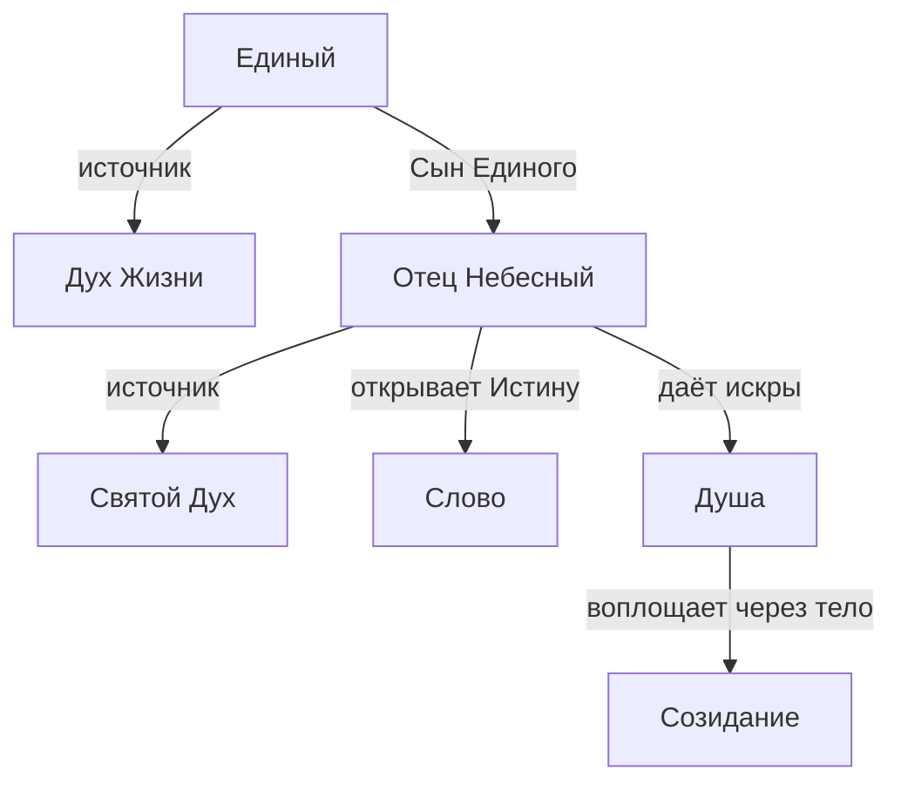

# Карта связей

Прямое указание означает, что тезис сформулирован в источнике. Сопоставление опирается на несколько мест и выражает вывод редактора.

## От Единого и Отца к духовному пути человека

Основание — [E02](evidence.md#e02), [E09](evidence.md#e09), [E36](evidence.md#e36), [E39](evidence.md#e39), [E50](evidence.md#e50).

## Полный список связей

| От понятия | Связь | К понятию | Основание |
| --- | --- | --- | --- |
| Единый | источник | Дух Жизни | Прямое указание. [E01](evidence.md#e01), [E39](evidence.md#e39), [E50](evidence.md#e50) |
| Отец Небесный | источник | Святой Дух | Прямое указание. [E39](evidence.md#e39), [E50](evidence.md#e50) |
| Единый | назван Отцом | Отец Небесный | Прямое указание. [E39](evidence.md#e39), [E50](evidence.md#e50) |
| Отец Небесный | являет Истину через | Слово | Прямое указание. [E09](evidence.md#e09) |
| Отец Небесный | источник | Душа | Прямое указание. [E02](evidence.md#e02), [E65](evidence.md#e65) |
| Земля-Матушка | участвует в возникновении | Отец Небесный | Прямое указание. [E02](evidence.md#e02), [E50](evidence.md#e50) |
| Единый | начало законов | Гармония | Прямое указание. [E01](evidence.md#e01), [E23](evidence.md#e23), [E50](evidence.md#e50) |
| Подвижный Разум | постигает | Гармония | Прямое указание. [E07](evidence.md#e07), [E08](evidence.md#e08) |
| Гармония | допускает | Запас прочности | Прямое указание. [E31](evidence.md#e31) |
| Гармония | задаёт уровень | Норма | Прямое указание. [E68](evidence.md#e68) |
| Четыре Ипостаси | включает | Единый | Прямое указание. [E39](evidence.md#e39) |
| Четыре Ипостаси | включает | Отец Небесный | Прямое указание. [E39](evidence.md#e39) |
| Четыре Ипостаси | включает | Дух Жизни | Прямое указание. [E39](evidence.md#e39) |
| Четыре Ипостаси | включает | Святой Дух | Прямое указание. [E39](evidence.md#e39) |
| Пять Основ | добавляет природную основу | Земля-Матушка | Прямое указание. [E49](evidence.md#e49) |
| Пять Основ | пересекается по составу | Четыре Ипостаси | Сопоставление. [E39](evidence.md#e39), [E49](evidence.md#e49) |
| Плоть | воплощает деятельность | Душа | Прямое указание. [E03](evidence.md#e03), [E36](evidence.md#e36), [E38](evidence.md#e38), [E65](evidence.md#e65) |
| Плоть | служит инструментом | Созидание | Прямое указание. [E31](evidence.md#e31), [E46](evidence.md#e46) |
| Плоть | носитель | Подвижный Разум | Прямое указание. [E08](evidence.md#e08), [E65](evidence.md#e65) |
| Душа | может направлять | Подвижный Разум | Прямое указание. [E32](evidence.md#e32), [E65](evidence.md#e65) |
| Инстинкты | влияют на | Подвижный Разум | Прямое указание. [E32](evidence.md#e32), [E64](evidence.md#e64) |
| Инстинкты | влияют на | Призма восприятия | Прямое указание. [E66](evidence.md#e66) |
| Эгоизм и самоутверждение | окрашивает | Призма восприятия | Прямое указание. [E66](evidence.md#e66), [E74](evidence.md#e74), [E75](evidence.md#e75) |
| Призма восприятия | затрудняет | Любовь к врагам | Сопоставление. [E45](evidence.md#e45), [E74](evidence.md#e74), [E75](evidence.md#e75), [E76](evidence.md#e76) |
| Храм души | строится через | Созидание | Сопоставление. [E03](evidence.md#e03), [E36](evidence.md#e36) |
| Душа | имеет | Свобода Выбора | Прямое указание. [E08](evidence.md#e08), [E28](evidence.md#e28) |
| Свобода Выбора | может изменить | Вынужденная судьба | Прямое указание. [E28](evidence.md#e28) |
| Свобода Выбора | допускает | Грех | Сопоставление. [E06](evidence.md#e06), [E26](evidence.md#e26), [E28](evidence.md#e28) |
| Рождение Свыше | открывает | Предначертание | Прямое указание. [E14](evidence.md#e14), [E28](evidence.md#e28), [E29](evidence.md#e29) |
| Предначертание | раскрывает | Индивидуальность | Прямое указание. [E21](evidence.md#e21), [E29](evidence.md#e29) |
| Индивидуальность | проявляется в | Мастерство | Сопоставление. [E21](evidence.md#e21), [E46](evidence.md#e46), [E47](evidence.md#e47) |
| Культура и Красота | ограняет | Индивидуальность | Прямое указание. [E29](evidence.md#e29) |
| Мастерство | служит | Созидание | Прямое указание. [E46](evidence.md#e46), [E47](evidence.md#e47) |
| Мастерство | учитывает нужду в | Помощь | Сопоставление. [E40](evidence.md#e40), [E47](evidence.md#e47), [E56](evidence.md#e56) |
| Вера | даёт силу | Свобода Выбора | Прямое указание. [E08](evidence.md#e08), [E15](evidence.md#e15) |
| Священная Вера | выражается в | Созидание | Прямое указание. [E41](evidence.md#e41), [E42](evidence.md#e42), [E71](evidence.md#e71) |
| Вера | усиливает | Мысль | Прямое указание. [E15](evidence.md#e15) |
| Мысль | может подпитывать | Дух зла | Прямое указание. [E15](evidence.md#e15), [E16](evidence.md#e16) |
| Дух зла | усиливает | Соблазн | Прямое указание. [E04](evidence.md#e04), [E16](evidence.md#e16) |
| Соблазн | даёт случай проявить | Свобода Выбора | Сопоставление. [E06](evidence.md#e06), [E08](evidence.md#e08), [E34](evidence.md#e34), [E58](evidence.md#e58) |
| Покаяние | связано с | Прощение | Прямое указание. [E25](evidence.md#e25), [E26](evidence.md#e26), [E58](evidence.md#e58) |
| Прощение | различается с последствиями | Гармония | Прямое указание. [E26](evidence.md#e26) |
| Молитва | укрепляет связь с | Отец Небесный | Прямое указание. [E06](evidence.md#e06), [E60](evidence.md#e60) |
| Молитва | связывает | Единая Духовная Семья | Прямое указание. [E60](evidence.md#e60), [E61](evidence.md#e61) |
| Молитва | связана с отдачей | Тепло души | Прямое указание. [E60](evidence.md#e60), [E61](evidence.md#e61) |
| Благодать | принимается через | Молитва | Прямое указание. [E06](evidence.md#e06), [E60](evidence.md#e60) |
| Благодать | продолжает течение через | Тепло души | Прямое указание. [E33](evidence.md#e33), [E58](evidence.md#e58), [E61](evidence.md#e61) |
| Тепло души | выражает | Любовь к врагам | Прямое указание. [E54](evidence.md#e54), [E57](evidence.md#e57) |
| Триединство любви | расширяет | Семья | Сопоставление. [E17](evidence.md#e17), [E18](evidence.md#e18), [E45](evidence.md#e45) |
| Любовь к врагам | область труда | Триединство любви | Сопоставление. [E18](evidence.md#e18), [E45](evidence.md#e45), [E54](evidence.md#e54), [E57](evidence.md#e57) |
| Воспитание | развивает | Воображение | Прямое указание. [E35](evidence.md#e35) |
| Чудо | используется в | Воспитание | Прямое указание. [E35](evidence.md#e35) |
| Чудо | ограничено как доказательство | Ступени раскрытия Истины | Прямое указание. [E22](evidence.md#e22), [E23](evidence.md#e23), [E53](evidence.md#e53) |
| Равнодушие | отмечает черту в | Царство силы | Прямое указание. [E10](evidence.md#e10) |
| Царство силы | сменяется | Царство Души | Прямое указание. [E10](evidence.md#e10), [E11](evidence.md#e11), [E48](evidence.md#e48) |
| Священная Вера | способствует переходу в | Царство Души | Прямое указание. [E11](evidence.md#e11) |
| Поворот и рубежи | ведёт к | Царство Души | Прямое указание. [E48](evidence.md#e48), [E52](evidence.md#e52), [E73](evidence.md#e73) |
| Поворот и рубежи | включает испытание | Огненное крещение | Прямое указание. [E71](evidence.md#e71), [E73](evidence.md#e73) |
| Последний Завет | обращён к | Спасение | Прямое указание. [E48](evidence.md#e48), [E52](evidence.md#e52), [E54](evidence.md#e54) |
| Ступени раскрытия Истины | разворачивает | Единое Учение | Сопоставление. [E09](evidence.md#e09), [E20](evidence.md#e20), [E49](evidence.md#e49), [E52](evidence.md#e52) |
| Религиозные соответствия | соотносятся с | Единое Учение | Прямое указание. [E20](evidence.md#e20), [E49](evidence.md#e49), [E51](evidence.md#e51) |
| Единая Духовная Семья | выражает | Единое Учение | Сопоставление. [E20](evidence.md#e20), [E21](evidence.md#e21), [E60](evidence.md#e60), [E61](evidence.md#e61) |
| Переселение души | даёт возможность развивать | Душа | Прямое указание. [E12](evidence.md#e12), [E13](evidence.md#e13) |
| Высший Мир | описан рядом с | Низший мир | Прямое указание. [E12](evidence.md#e12), [E13](evidence.md#e13) |
| Гармония с Природой | учитывает | Гармония | Прямое указание. [E27](evidence.md#e27), [E31](evidence.md#e31), [E37](evidence.md#e37), [E59](evidence.md#e59) |
| Норма | служит рубежом | Поворот и рубежи | Сопоставление. [E68](evidence.md#e68), [E72](evidence.md#e72), [E73](evidence.md#e73) |
